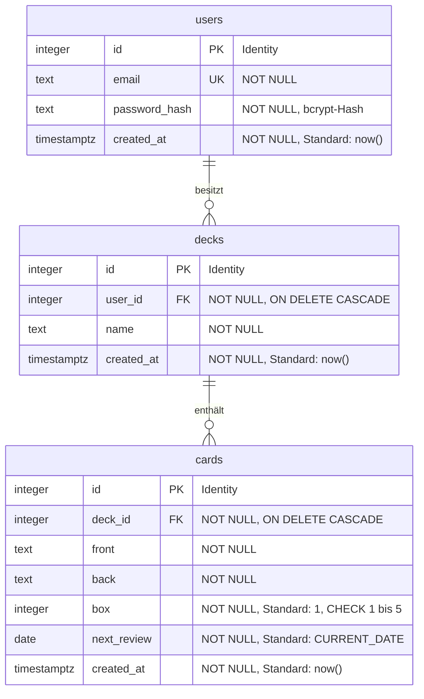

# Datenmodell
Die Karteikarten app benutzt eine PostgreSQL-Datenbank mit drei Tabellen.
Für die technische umsetzung der PostgreSQL Datenbank wurde eine [docker-compose.yml](../backend/docker-compose.yml) Datei erstellt  
um die DB lokal zu deployen.
Für die erstellung, konfiguration und wartbarkeit des Datenmodells wurde Drizzle ORM verwendet. 
- Das Schema liegt in [schema.ts](../backend/src/db/schema.ts)
- Die erzeugte SQL-Migrationen liegen in [migrations](../backend/drizzle)

## ERM Diagramm

*Diagramm erstellt mit Mermaid, mit Unterstützung von Claude (Anthropic Opus 5.5).

## Beziehungen

- Ein Nutzer besitzt beliebig viele Stapel, jeder Stapel gehört genau einem Nutzer.
- Ein Stapel enthält beliebig viele Karten, jede Karte liegt in genau einem Stapel.
- Wird ein Nutzer gelöscht, werden seine Stapel und deren Karten automatisch mitgelöscht (cascade)
- Karten haben keine eigene userid. Wem eine Karte gehört, ergibt sich über ihren Stapel.