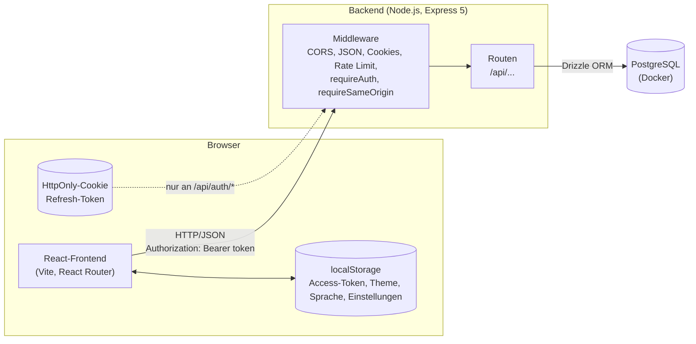

# Technische Dokumentation

**HOME** [README](../../README.md)

## Inhalt

| Dokument | Inhalt |
|----------|--------|
| [Setup](setup.md) | Projekt lokal einrichten und starten, Umgebungsvariablen, npm-Skripte, häufige Fehler |
| [API](api.md) | Alle Endpunkte des Backends: Decks, Karten, Lernmodus, Health |
| [Authentication](authentication.md) | Registrierung (`POST /api/register`) mit Beispielen |
| [JWT](jwt.md) | Login, Token-Aufbau, geschützte Routen, Sicherheit |
| [Mehrsprachigkeit](i18n.md) | Deutsch und Englisch: Texte hinzufügen, Fehlercodes übersetzen, neue Sprache |
| [KI-Anbindung](ai.md) | OpenRouter einrichten, Antwortprüfung, Datenschutz und Sicherheit |
| [Tests](testing.md) | Vitest in Backend und Frontend: ausführen, Aufbau, was getestet wird |
| [Datenmodell](../Datenmodell.md) | Tabellen und Beziehungen der PostgreSQL-Datenbank |

## Architektur im Überblick



| Teil | Technik | Ordner |
|------|---------|--------|
| Frontend | React 19, TypeScript, Vite, React Router, i18next / react-i18next, lucide-react | [frontend/](../../frontend) |
| Backend | Node.js, Express 5, TypeScript, jose (JWT), argon2, validator, cookie-parser | [backend/](../../backend) |
| Datenbank | PostgreSQL 18 in Docker, Drizzle ORM für Schema und Migrationen | [backend/drizzle/](../../backend/drizzle) |
| CI | GitHub Actions: Build und Tests (Backend, Frontend) und ESLint (Frontend) bei Push und Pull Request auf `main` und `develop` | [.github/workflows/ci.yml](../../.github/workflows/ci.yml) |

### Aufbau des Frontends

```
frontend/src/
├── api/          Kommunikation mit dem Backend
│   ├── client.ts     zentraler API-Client (fetch-Wrapper): Basis-URL, Token, Fehler
│   └── auth.ts, decks.ts, cards.ts, review.ts, chat.ts, stats.ts   eine Funktion pro Endpunkt
├── components/   Layout (Kopfzeile), LanguageSwitch / LanguageOptions (Sprachauswahl), ProtectedRoute, GuestRoute, Modal, ConfirmDialog, SettingsDialog
├── features/     Bausteine einzelner Seiten
│   ├── decks/        DeckItem (Zeile der Deck-Liste)
│   ├── cards/        CardForm, CardItem, BoxBar (Verteilung auf die Fächer)
│   ├── learn/        Flashcard (Karteikarte), LearnSession (Ablauf einer Runde), AnswerInput (Antwort eintippen), AiResult (Ergebnis der KI-Prüfung), CardChat (Chat mit der KI), BoxFilter (Auswahl beim freien Üben)
│   └── stats/        ActivityChart (Antworten pro Tag, ohne Chart-Bibliothek)
├── i18n/         Mehrsprachigkeit: Einrichtung, Texte (locales/de.ts, en.ts), Übersetzung der Fehlercodes
├── hooks/        useTheme (Hell/Dunkel), useApiError (Fehlermeldung, bei 401 abmelden), useSettings
├── lib/          Hilfsfunktionen ohne React: date.ts, leitner.ts, shuffle.ts, settings.ts (Einstellungen im localStorage)
├── pages/        eine Datei pro Seite (Login, Register, Decks, DeckDetail, Learn, Practice, Dashboard)
├── styles/       tokens.css (Design-Variablen), base.css (Bausteine)
├── test/         setup.ts für Vitest (Tests selbst liegen als *.test.ts neben den Dateien)
└── types/        Typen für Deck, Card, Stats, Check (KI-Prüfung) und Chat
```

### Aufbau des Backends

```
backend/src/
├── index.ts      startet den Server
├── app.ts        Express-App: Middleware und Routen
├── jwt.ts        Token erstellen und prüfen
├── db/           Verbindung (db.ts) und Schema (schema.ts)
├── lib/          Fachlogik ohne HTTP: errors.ts (Fehlercodes), refreshTokens.ts und refreshCookie.ts (Refresh-Token), leitner.ts, stats.ts (Statistik), ai.ts (OpenRouter-Client), answerCheck.ts (KI-Prüfung), cardChat.ts (KI-Chat)
├── middleware/   auth.ts (requireAuth), sameOrigin.ts (CSRF-Schutz), rateLimit.ts
└── routes/       ein Router pro Bereich (register, login, auth, decks, cards, review, check, chat, stats, health)
```
