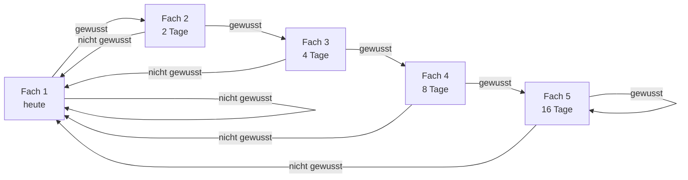

# API

**HOME** [README](../../README.md) · [Technische Dokumentation](README.md)

Das Backend stellt eine JSON-API unter `http://localhost:3000/api` bereit (Port aus `PORT` in der `.env`).

## Allgemeines

### Authentifizierung
Alle Endpunkte außer Health, Registrierung und Login sind geschützt (Middleware `requireAuth`). Der Client schickt das Token aus dem Login im Header mit:

```
Authorization: Bearer <token>
```

Fehlt das Token, ist es ungültig oder abgelaufen, antwortet der Server mit `401 { "message": "unauthorized" }`.
Der Nutzer ergibt sich immer aus dem Token. Jeder Nutzer sieht und ändert nur seine eigenen Decks und Karten. Fremde Decks oder Karten liefern `404`, als gäbe es sie nicht.
Details: [JWT](jwt.md)

### Request-Body
Requests mit Body senden JSON mit dem Header `Content-Type: application/json`.

### Fehlerformat
Fehler werden als JSON mit einer Meldung beantwortet:

```json
{ "message": "Deck not found" }
```

Die Meldungen sind auf Englisch und für Entwickler gedacht. Das Frontend sollte sich am Statuscode orientieren.

### Statuscodes

| Status | Bedeutung |
|--------|-----------|
| 200 | Erfolg |
| 201 | Erfolgreich angelegt |
| 204 | Erfolgreich gelöscht, kein Body |
| 400 | Ungültige Eingabe (falscher Typ, leer, zu lang, ungültige ID) |
| 401 | Nicht angemeldet oder Token ungültig |
| 404 | Nicht gefunden oder gehört einem anderen Nutzer |
| 409 | Konflikt, z. B. E-Mail bereits registriert |
| 429 | Zu viele Anfragen (Rate Limit) |
| 500 | Interner Serverfehler (Details nur im Server-Log) |
| 503 | KI-Prüfung nicht verfügbar (kein Key, Timeout, Fehler bei OpenRouter) |

### Rate Limits
Pro Minute, `authLimit` und `apiLimit` pro IP-Adresse, `aiLimit` pro Nutzer:

| Limit | Anfragen/Min. | Gilt für |
|-------|---------------|----------|
| `authLimit` | 15 | Registrierung, Login |
| `apiLimit` | 80 | Decks, Karten, Lernmodus, Statistik, `GET /api/health/db` |
| `aiLimit` | 20 | KI-Prüfung und KI-Chat (`/check`, `/chat`), gemeinsam |

Wird ein Limit überschritten, antwortet der Server mit `429 { "message": "too many requests, try again later" }`. Die Header `RateLimit-*` zeigen den aktuellen Stand.

### Übersicht

| Methode | Pfad | Geschützt | Beschreibung |
|---------|------|-----------|--------------|
| GET | `/api/health` | nein | Server läuft |
| GET | `/api/health/db` | nein | Datenbank erreichbar |
| POST | `/api/register` | nein | Konto anlegen, siehe [Authentication](authentication.md) |
| POST | `/api/login` | nein | Anmelden, liefert Token, siehe [JWT](jwt.md) |
| GET | `/api/decks` | ja | Eigene Decks auflisten |
| GET | `/api/decks/:id` | ja | Ein Deck mit Kartenanzahl |
| POST | `/api/decks` | ja | Deck anlegen |
| PATCH | `/api/decks/:id` | ja | Deck umbenennen |
| DELETE | `/api/decks/:id` | ja | Deck mit allen Karten löschen |
| GET | `/api/decks/:deckId/cards` | ja | Alle Karten eines Decks |
| POST | `/api/decks/:deckId/cards` | ja | Karte anlegen |
| PATCH | `/api/cards/:id` | ja | Karte ändern |
| DELETE | `/api/cards/:id` | ja | Karte löschen |
| GET | `/api/decks/:deckId/review` | ja | Heute fällige Karten eines Decks |
| POST | `/api/cards/:id/review` | ja | Antwort speichern (Leitner) |
| GET | `/api/stats` | ja | Lernstatistik des Nutzers |
| POST | `/api/cards/:id/check` | ja | Antwort von der KI prüfen lassen (nur Vorschlag) |
| POST | `/api/cards/:id/chat` | ja | Frage an die KI zu einer Karte |

IDs in Pfaden müssen positive ganze Zahlen sein, sonst `400`.

---

## Health

### `GET /api/health`
Prüft, ob der Server läuft. Kein Rate Limit.

```json
{ "status": "ok", "uptime": 12.34, "timestamp": "2026-11-27T08:00:00.000Z" }
```

### `GET /api/health/db`
Prüft, ob die Datenbank erreichbar ist.

| Status | Body |
|--------|------|
| 200 | `{ "status": "ok", "database": "up" }` |
| 503 | `{ "status": "error", "database": "down" }` |

---

## Decks

Ein Deck (im Frontend "Stapel") ist ein Ordner für Karten.

```json
{ "id": 1, "name": "Webentwicklung" }
```

### `GET /api/decks`
Alle Decks des angemeldeten Nutzers, sortiert nach ID, mit Anzahl der Karten und der heute fälligen Karten.

**Antwort `200`**
```json
{ "decks": [ { "id": 1, "name": "Webentwicklung", "card_count": 12, "due_count": 4 } ] }
```

| Feld | Bedeutung |
|------|-----------|
| `card_count` | Anzahl aller Karten im Deck |
| `due_count` | Karten mit `next_review` ≤ heute, also genau die, die `GET /api/decks/:deckId/review` liefert. "Heute" berechnet die Datenbank (`CURRENT_DATE`) |

### `GET /api/decks/:id`
Ein Deck des angemeldeten Nutzers, mit denselben Feldern wie in der Liste.

**Antwort `200`**
```json
{ "deck": { "id": 1, "name": "Webentwicklung", "card_count": 12, "due_count": 4 } }
```

Fehler: `400` (ungültige ID), `404 { "message": "Deck not found" }`.

### `POST /api/decks`
Legt ein Deck an. Die Antwort enthält nur `id` und `name`, ein neues Deck hat noch keine Karten.

| Feld | Typ | Regeln |
|------|-----|--------|
| `name` | string | wird getrimmt, 1 bis 60 Zeichen |

**Antwort `201`**
```json
{ "deck": { "id": 2, "name": "Datenbanken" } }
```

Fehler: `400` (kein String, leer oder zu lang).

### `PATCH /api/decks/:id`
Benennt ein Deck um. Body und Regeln wie bei `POST`.

**Antwort `200`**
```json
{ "deck": { "id": 2, "name": "Datenbanken 2" } }
```

Fehler: `400`, `404 { "message": "deck not found" }`.

### `DELETE /api/decks/:id`
Löscht ein Deck. Alle Karten darin werden von der Datenbank mitgelöscht (`ON DELETE CASCADE`).

**Antwort `204`** ohne Body.

Fehler: `400`, `404 { "message": "Deck not found" }`.

---

## Karten

```json
{
  "id": 7,
  "front": "Was ist ein JWT?",
  "back": "Ein signiertes Token, mit dem sich der Client ausweist.",
  "box": 1,
  "next_review": "2026-11-27"
}
```

| Feld | Bedeutung |
|------|-----------|
| `box` | Leitner-Fach 1 bis 5 (siehe [Lernmodus](#lernmodus-leitner)) |
| `next_review` | Datum (`YYYY-MM-DD`), ab dem die Karte wieder fällig ist |

Neue Karten starten in Fach 1 und sind sofort fällig.

### `GET /api/decks/:deckId/cards`
Alle Karten eines Decks, unabhängig von der Fälligkeit.

**Antwort `200`**
```json
{ "cards": [ { "id": 7, "front": "...", "back": "...", "box": 1, "next_review": "2026-11-27" } ] }
```

Fehler: `400` (ungültige Deck-ID), `404 { "message": "Deck not found" }`.

### `POST /api/decks/:deckId/cards`
Legt eine Karte im Deck an.

| Feld | Typ | Regeln |
|------|-----|--------|
| `front` | string | wird getrimmt, 1 bis 1000 Zeichen |
| `back` | string | wird getrimmt, 1 bis 1000 Zeichen |

**Antwort `201`**
```json
{ "card": { "id": 8, "front": "...", "back": "...", "box": 1, "next_review": "2026-11-27" } }
```

Fehler: `400`, `404` (Deck nicht gefunden).

### `PATCH /api/cards/:id`
Ändert Vorder- und/oder Rückseite. Nur mitgeschickte Felder werden geändert, mindestens eins ist Pflicht. Fach und Fälligkeit bleiben unverändert.

| Feld | Typ | Regeln |
|------|-----|--------|
| `front` | string (optional) | wird getrimmt, 1 bis 1000 Zeichen |
| `back` | string (optional) | wird getrimmt, 1 bis 1000 Zeichen |

**Antwort `200`**
```json
{ "card": { "id": 8, "front": "...", "back": "...", "box": 1, "next_review": "2026-11-27" } }
```

Fehler: `400` (z. B. `no changes given`), `404 { "message": "Card not found" }`.

### `DELETE /api/cards/:id`
Löscht eine Karte.

**Antwort `204`** ohne Body.

Fehler: `400`, `404`.

---

## Lernmodus (Leitner)

Die Karten werden nach dem Leitner-System wiederholt. Die Logik liegt komplett im Backend ([leitner.ts](../../backend/src/lib/leitner.ts)), das Frontend meldet nur "gewusst" oder "nicht gewusst".

| Fach | Nächste Wiederholung nach |
|------|---------------------------|
| 1 | sofort (heute erneut fällig) |
| 2 | 2 Tagen |
| 3 | 4 Tagen |
| 4 | 8 Tagen |
| 5 | 16 Tagen (gelernt) |

- **Gewusst:** ein Fach höher (höchstens Fach 5)
- **Nicht gewusst:** zurück in Fach 1 und heute erneut fällig, damit die Karte direkt wiederholt werden kann. Der Lernmodus im Frontend hängt sie dafür ans Ende der laufenden Runde.
- `next_review` = heute + Intervall des neuen Fachs. "Heute" berechnet die Datenbank (`CURRENT_DATE`), damit Abfrage und Speicherung dasselbe Datum nutzen.



### `GET /api/decks/:deckId/review`
Alle **heute fälligen** Karten eines Decks (`next_review` ≤ heute). Die Liste kann leer sein, dann gibt es heute nichts zu lernen.

**Antwort `200`**
```json
{ "cards": [ { "id": 7, "front": "...", "back": "...", "box": 2, "next_review": "2026-11-25" } ] }
```

Fehler: `400`, `404 { "message": "Deck not found" }`.

### `POST /api/cards/:id/review`
Speichert die Antwort und verschiebt die Karte. Die Antwort wird außerdem in der Lernhistorie (Tabelle `reviews`) gespeichert, beides in einer Transaktion.

| Feld | Typ | Regeln |
|------|-----|--------|
| `correct` | boolean | `true` = gewusst, `false` = nicht gewusst |
| `practice` | boolean, optional | Standard `false`. `true` = Antwort aus dem freien Üben: Die Karte wird verschoben, die Antwort zählt aber **nicht** in der Statistik |

**Antwort `200`**: die Karte mit neuem Fach und neuem Datum
```json
{ "card": { "id": 7, "front": "...", "back": "...", "box": 3, "next_review": "2026-12-01" } }
```

Fehler: `400` (z. B. `correct must be a boolean`, `practice must be a boolean`), `404 { "message": "Card not found" }`.

---

## KI-Prüfung

### `POST /api/cards/:id/check`
Lässt eine eingetippte Antwort von einem Sprachmodell prüfen. Nur ein **Vorschlag**: Die Karte wird nicht verändert, die Bewertung speichert weiterhin `POST /api/cards/:id/review`. Einrichtung, Datenschutz und Sicherheit: [KI-Anbindung](ai.md).

| Feld | Typ | Regeln |
|------|-----|--------|
| `answer` | string | nicht leer, höchstens 500 Zeichen |

**Antwort `200`**
```json
{
  "verdict": "partial",
  "feedback": "Frontend und Backend stimmen, die Datenbank fehlt.",
  "explanation": "Eine Client-Server-Webanwendung trennt Darstellung, Logik und Speicherung ..."
}
```

| Feld | Inhalt |
|------|--------|
| `feedback` | 1–2 Sätze zur eingetippten Antwort, höchstens 300 Zeichen |
| `explanation` | 2–4 Sätze zur Lösung selbst (was der Begriff bedeutet, warum), höchstens 800 Zeichen. Kann leer sein |

| `verdict` | Bedeutung |
|-----------|-----------|
| `correct` | inhaltlich richtig (Rechtschreibung, Synonyme egal) |
| `partial` | teilweise richtig |
| `wrong` | falsch oder ohne Bezug |

Fehler: `400` (z. B. `answer must be a non-empty string`), `404 { "message": "Card not found" }`, `429` (`aiLimit`), `503 { "message": "AI check not available" }`, wenn kein Key gesetzt ist oder OpenRouter nicht antwortet.

### `POST /api/cards/:id/chat`
Frage an die KI zu einer Karte. **Es wird nichts gespeichert:** Das Frontend schickt bei jeder Frage den ganzen bisherigen Verlauf mit.

| Feld | Typ | Regeln |
|------|-----|--------|
| `messages` | Array von `{ role, content }` | 1–10 Einträge, `role` nur `user` oder `assistant`, abwechselnd, beginnt und endet mit `user`. `content` nicht leer, bei `user` höchstens 1000, bei `assistant` (frühere Antworten) höchstens 1500 Zeichen |
| `answer` | string, optional | eingetippte Antwort, höchstens 500 Zeichen |
| `check` | `{ verdict, feedback }`, optional | Ergebnis von `/check`, damit die KI es kennt |

**Antwort `200`**
```json
{ "reply": "Ein JWT besteht aus drei Teilen: Header, Payload und Signatur. ..." }
```
`reply` ist normaler Text (höchstens 1500 Zeichen), ohne Formatierung.

Fehler: `400` (z. B. `role must be user or assistant`), `404 { "message": "Card not found" }`, `429` (`aiLimit`), `503 { "message": "AI chat not available" }`.

---

## Statistik

### `GET /api/stats`
Lernstatistik über alle Stapel des angemeldeten Nutzers.

**Antwort `200`**
```json
{
  "today": "2026-11-27",
  "streak": 3,
  "total": { "answers": 120, "correct": 90, "accuracy": 75 },
  "period": { "days": 14, "answers": 40, "correct": 32, "accuracy": 80 },
  "days": [ { "date": "2026-11-14", "correct": 0, "wrong": 0 }, "…", { "date": "2026-11-27", "correct": 5, "wrong": 1 } ],
  "cards": { "total": 50, "due": 6, "learned": 12, "boxes": [10, 8, 12, 8, 12] }
}
```

| Feld | Bedeutung |
|------|-----------|
| `streak` | Tage in Folge mit mindestens einer Antwort. Ist heute noch nichts beantwortet, zählt die Serie bis gestern, damit sie morgens nicht auf 0 fällt |
| `total`, `period` | Antworten und davon gewusst, gesamt bzw. in den letzten `period.days` Tagen (inkl. heute). `accuracy` in Prozent (gerundet), `null` ohne Antworten |
| `days` | die letzten `period.days` Tage, älteste zuerst, Tage ohne Antwort mit `0` |
| `cards` | aktueller Stand: Karten gesamt, heute fällig (wie `due_count`), gelernt (Fach 5), `boxes` = Anzahl pro Fach (Index 0 = Fach 1) |

**Tage und Zeitzone:** Antworten werden nach dem Kalendertag in deutscher Zeit (`Europe/Berlin`) gezählt, eine Antwort um 00:30 gehört also zum neuen Tag. Die Datenbank läuft in UTC, deshalb rechnet die Statistik die Zeitzone selbst um. `cards.due` nutzt wie der Lernmodus `CURRENT_DATE` der Datenbank.

Gezählt werden nur Antworten im Lernmodus. Antworten vor Einführung der Statistik gibt es nicht (keine Historie vor der Migration `0001_reviews`).

---

## Beispiel (curl)

Token aus dem Login in eine Variable legen und damit arbeiten:

```bash
TOKEN=$(curl -s -X POST http://localhost:3000/api/login \
  -H "Content-Type: application/json" \
  -d '{"email": "test@example.com", "password": "geheim123"}' | sed -E 's/.*"token":"([^"]+)".*/\1/')

# Deck anlegen
curl -i -X POST http://localhost:3000/api/decks \
  -H "Authorization: Bearer $TOKEN" \
  -H "Content-Type: application/json" \
  -d '{"name": "Webentwicklung"}'

# Karte im Deck 1 anlegen
curl -i -X POST http://localhost:3000/api/decks/1/cards \
  -H "Authorization: Bearer $TOKEN" \
  -H "Content-Type: application/json" \
  -d '{"front": "Was ist ein JWT?", "back": "Ein signiertes Token."}'

# Fällige Karten von Deck 1
curl -i http://localhost:3000/api/decks/1/review \
  -H "Authorization: Bearer $TOKEN"

# Karte 1 als gewusst markieren
curl -i -X POST http://localhost:3000/api/cards/1/review \
  -H "Authorization: Bearer $TOKEN" \
  -H "Content-Type: application/json" \
  -d '{"correct": true}'
```

## Bekannte Einschränkungen

- "Heute" für fällige Karten ist `CURRENT_DATE` der Datenbank, also UTC. Zwischen 0 und 1 Uhr (Sommerzeit: 2 Uhr) deutscher Zeit gilt dort noch der Vortag. Die Statistik rechnet dagegen schon in `Europe/Berlin`.
- Die Fehlermeldungen sind nur auf Englisch und ohne festen Fehlercode. Geplant in Issue [#2](https://github.com/PhilipWie/flashcards-app/issues/2).
