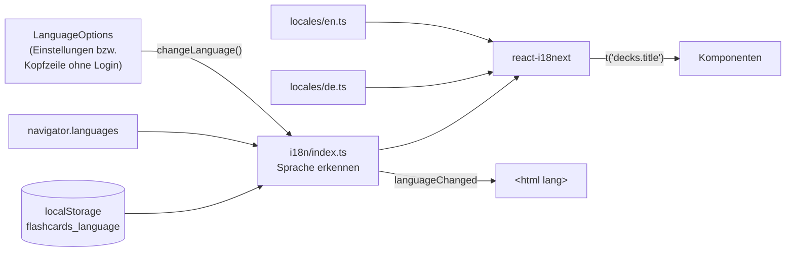

# Mehrsprachigkeit (i18n)

**HOME** [README](../../README.md) · [Technische Dokumentation](README.md)

Die Oberfläche gibt es auf **Deutsch** und **Englisch**. Wo umgeschaltet wird:

- **Angemeldet:** in den Einstellungen (Zahnrad), Abschnitt „Sprache“.
- **Nicht angemeldet** (Login, Registrierung): oben in der Kopfzeile. Der Button mit dem Sprach-Symbol zeigt die aktuelle Sprache (`DE`/`EN`) und öffnet einen kleinen Dialog.

Beide nutzen dieselbe Radio-Gruppe (`LanguageOptions`) im Stil der übrigen Einstellungen. Alle Texte wechseln sofort, ohne Neuladen.

Verwendet werden [i18next](https://www.i18next.com) und [react-i18next](https://react.i18next.com).

## Welche Sprache gilt?

1. Die zuletzt gewählte Sprache. Sie steht im `localStorage` unter `flashcards_language` und gilt nur in diesem Browser.
2. Sonst die erste unterstützte Sprache des Browsers (`navigator.languages`, z. B. `de-AT` → `de`).
3. Sonst **Englisch** (`FALLBACK_LANGUAGE`).

`<html lang>` folgt der gewählten Sprache. Das brauchen Screenreader für die richtige Aussprache, und die Silbentrennung in CSS hängt auch davon ab.

## Aufbau

```
frontend/src/i18n/
├── index.ts        i18next einrichten, Sprache erkennen, changeLanguage(), LANGUAGES
├── i18next.d.ts    TypeScript: erlaubte Schlüssel kommen aus de.ts
├── errorCodes.ts   Liste der Fehlercodes des Backends (Kopie von backend/src/lib/errors.ts)
├── apiErrors.ts    Fehlercode des Backends -> übersetzte Meldung
└── locales/
    ├── de.ts       deutsche Texte, legt die Schlüssel fest
    └── en.ts       englische Texte, muss dieselben Schlüssel haben
```



Die Texte liegen als TypeScript-Dateien vor, nicht als JSON. So prüft TypeScript, dass `en.ts` genau dieselben Schlüssel hat wie `de.ts`.

## Texte in Komponenten

```tsx
import { useTranslation } from "react-i18next";

function Example({ deck }: { deck: DeckSummary }) {
    const { t } = useTranslation();
    return (
        <>
            <h1>{t("decks.title")}</h1>
            {/* Platzhalter */}
            <label>{t("decks.renameLabel", { name: deck.name })}</label>
            {/* Plural: wählt decks.count_one oder decks.count_other */}
            <p>{t("decks.count", { count: 3 })}</p>
        </>
    );
}
```

- **Tippfehler fallen beim Build auf.** `t("decks.titel")` ist ein TypeScript-Fehler, weil die Schlüssel aus `de.ts` stammen (`i18next.d.ts`).
- **Plural:** zwei Schlüssel `name_one` und `name_other`. Aufgerufen wird `t("name", { count })`. i18next wählt die Form über `Intl.PluralRules`.
- **Links im Text:** Den Text in `<link>…</link>` setzen und mit `<Trans>` ausgeben:
  ```tsx
  <Trans i18nKey="dashboard.noCards" components={{ link: <Link to="/decks" /> }} />
  ```
- **Datumsangaben** formatiert `Intl.DateTimeFormat` mit `i18n.language`, z. B. `formatDate(iso, i18n.language)`: `01.12.2026` (de) bzw. `12/01/2026` (en).
- **Platzhalter sind sicher:** `escapeValue: false` ist gesetzt, weil React jede Ausgabe ohnehin maskiert. Deck-Namen und Kartentexte werden also nicht als HTML ausgeführt.

## Fehlermeldungen des Backends

Das Backend schickt bei Fehlern `{ code, message }` (siehe [API, Fehlerformat](api.md#fehlerformat)). Das Frontend zeigt nie die englische `message`, sondern übersetzt den `code`:

- `apiErrorMessage(err, t)` in `i18n/apiErrors.ts` gibt den Text aus `errors.<CODE>` zurück. Angenommen werden nur Codes aus `ERROR_CODES` in `i18n/errorCodes.ts`.
- `errors` in `de.ts` ist mit `satisfies ErrorTexts` geprüft: Fehlt die Übersetzung eines Codes, meldet TypeScript einen Fehler.
- Unbekannter Code (z. B. nach einem Backend-Update): `errors.unknown` mit dem HTTP-Status.
- `fetch` selbst schlägt fehl (Backend läuft nicht): `errors.network`.
- `useApiError()` nutzt dieselbe Funktion und meldet bei `401` zusätzlich ab.

## Neuen Text hinzufügen

1. Schlüssel in `frontend/src/i18n/locales/de.ts` im passenden Bereich eintragen, z. B. `decks.archive: "Archivieren"`.
2. Denselben Schlüssel in `en.ts` eintragen. Fehlt er, meldet TypeScript einen Fehler.
3. In der Komponente `t("decks.archive")` verwenden.

Neuer Fehlercode im Backend: in `backend/src/lib/errors.ts` und `frontend/src/i18n/errorCodes.ts` ergänzen (die beiden Listen werden von Hand gleich gehalten), in `de.ts`/`en.ts` unter `errors` übersetzen (sonst Build-Fehler) und in der Tabelle in [api.md](api.md#fehlerformat) eintragen.

## Neue Sprache hinzufügen

1. `locales/fr.ts` anlegen, Aufbau wie `en.ts` (`const fr: Translation = { … }`).
2. In `i18n/index.ts` unter `LANGUAGES` eintragen (`{ code: "fr", label: "Français" }`, Name in der eigenen Sprache) und unter `resources` ergänzen.
3. Fertig: Der Sprach-Dialog und die Browser-Erkennung nutzen `LANGUAGES` (`short` ist das Kürzel im Button).

## Tests

Die Tests prüfen deutsche Texte. `src/test/setup.ts` stellt deshalb vor jedem Test auf Deutsch, unabhängig von der Sprache des Rechners. Die Tests für Spracherkennung, Fehlercodes und Umschalten stehen in [i18n.test.tsx](../../frontend/src/i18n/i18n.test.tsx).

## Bekannte Einschränkungen

- Eine Fehlermeldung, die schon angezeigt wird, bleibt beim Umschalten in der alten Sprache. Die nächste Meldung kommt in der neuen Sprache.
- Die Texte der KI richten sich nach dem Prompt im Backend, nicht nach der Sprache der Oberfläche: KI-Prüfung und KI-Chat antworten in der Sprache, in der der Nutzer schreibt (Antwort bzw. Frage). Die Oberflächensprache an die KI mitzuschicken wäre eine Änderung der API und ist hier nicht enthalten.
- Übersetzt wird nur die Oberfläche. Deck-Namen und Kartentexte bleiben, wie der Nutzer sie geschrieben hat.
