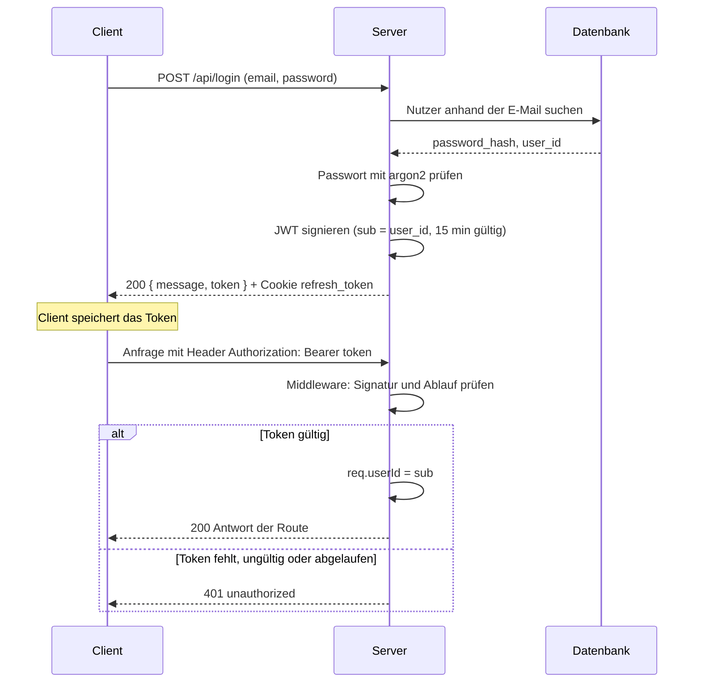
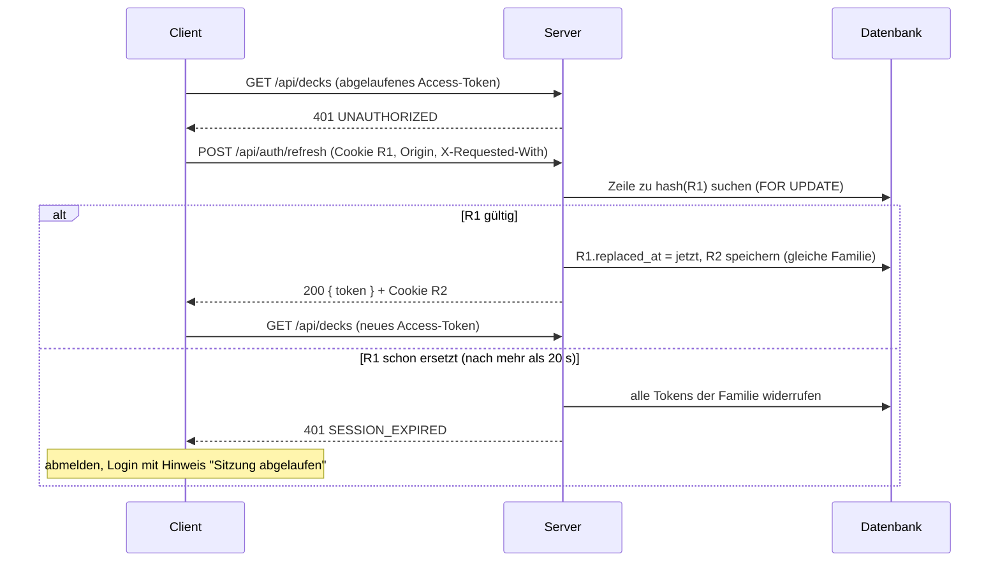

# JWT (JSON Web Token)

**HOME** [README](../../README.md) · [Authentication](authentication.md)

Nach dem Login bekommt der Client zwei Tokens:

- ein kurzlebiges **Access-Token** (JWT, 15 Minuten). Damit weist er sich bei jeder Anfrage aus, ohne dass der Server Sessions speichern muss.
- ein **Refresh-Token** als `HttpOnly`-Cookie. Damit holt er sich ein neues Access-Token, ohne sich neu anzumelden (siehe [Refresh-Token](#refresh-token)).

Umgesetzt mit der Library [jose](https://github.com/panva/jose) (JWT) und Node `crypto` (Refresh-Token).

- Token erstellen und prüfen: [jwt.ts](../../backend/src/jwt.ts)
- Token ausstellen: [login.ts](../../backend/src/routes/login.ts)
- Token bei geschützten Routen prüfen: [auth.ts](../../backend/src/middleware/auth.ts)
- Refresh-Token: [refreshTokens.ts](../../backend/src/lib/refreshTokens.ts), [routes/auth.ts](../../backend/src/routes/auth.ts), im Frontend [client.ts](../../frontend/src/api/client.ts)

## Was ist ein JWT?

Ein JWT besteht aus drei Teilen, getrennt durch Punkte: `header.payload.signature`

| Teil        | Inhalt                                                         |
|-------------|----------------------------------------------------------------|
| `header`    | Signatur-Algorithmus (bei uns `HS256`)                         |
| `payload`   | Daten (Claims): `sub` (User-ID), `iat` (erstellt), `exp` (Ablauf) |
| `signature` | Signatur über Header und Payload, erzeugt mit dem `JWT_SECRET` |

Wichtig:
- Header und Payload sind nur Base64-kodiert, **nicht verschlüsselt**. Jeder mit dem Token kann sie lesen. Deshalb stehen dort keine sensiblen Daten, nur die User-ID.
- Die Signatur schützt vor **Manipulation**. Ohne das Secret kann niemand ein gültiges Token erzeugen oder ein vorhandenes ändern.
- Wer das Token besitzt, gilt als der Nutzer (Bearer-Token). Das Token muss deshalb geschützt werden (siehe [Sicherheit](#sicherheit)).

## Ablauf



### 1. Login und Token ausstellen
`POST /api/login` prüft E-Mail und Passwort (argon2). Bei Erfolg wird mit `signToken(userId)` ein Token erzeugt und im Feld `token` der Antwort zurückgegeben.

Eigenschaften des Tokens:

| Claim | Wert                        |
|-------|-----------------------------|
| `sub` | User-ID als String          |
| `iat` | Zeitpunkt der Ausstellung   |
| `exp` | Ausstellung + 15 Minuten    |

Die Laufzeit steht in der Konstante `TOKEN_LIFETIME` in `jwt.ts`.

### 2. Token mitschicken
Der Client schickt das Token bei jeder Anfrage an eine geschützte Route im Header:

```
Authorization: Bearer <token>
```

### 3. Token prüfen
Die Middleware `requireAuth` übernimmt die Prüfung:
1. Header lesen, er muss mit `Bearer ` beginnen.
2. `verifyToken` prüft Signatur und Ablaufzeit. Der Algorithmus ist fest auf `HS256` gesetzt.
3. Bei Erfolg wird `req.userId` gesetzt, die Route kann damit arbeiten.
4. Bei jedem Fehler antwortet der Server mit `401 unauthorized`.

Die User-ID kommt immer aus dem Token (`req.userId`), nie aus dem Request-Body. So kann ein Nutzer nicht die Daten eines anderen anfordern.

## Refresh-Token

Ein Access-Token lässt sich nicht widerrufen, deshalb ist es nur 15 Minuten gültig. Damit sich der Nutzer trotzdem nicht ständig neu anmelden muss, gibt es das Refresh-Token.

| Eigenschaft | Wert |
|-------------|------|
| Inhalt | 32 zufällige Bytes (256 Bit), Base64url. Kein JWT, ohne Bedeutung |
| Speicherort im Browser | Cookie `refresh_token`: `HttpOnly`, `Secure`, `SameSite=Strict`, `Path=/api/auth`, kein `Domain` |
| Speicherort im Backend | Tabelle `refresh_tokens`, nur der **SHA-256-Hash** |
| Gültig ohne Nutzung | 1 Tag (`REFRESH_IDLE_MS`) |
| Gültig höchstens | 7 Tage ab Login (`REFRESH_ABSOLUTE_MS`), auch bei regelmäßiger Nutzung |

### Rotation und Diebstahl-Erkennung
Jedes Refresh-Token funktioniert genau einmal. `POST /api/auth/refresh` gibt ein neues Access-Token **und ein neues Refresh-Token** zurück, das alte bekommt `replaced_at`.



- **Familie:** Alle Tokens einer Anmeldung haben dieselbe `family_id`. Taucht ein schon ersetztes Token wieder auf, hat es vermutlich jemand kopiert. Dann wird die ganze Familie widerrufen, und Angreifer wie Nutzer müssen sich neu anmelden.
- **Kulanzzeit 20 Sekunden** (`REUSE_GRACE_MS`): Zwei fast gleichzeitige Anfragen mit demselben Token (z. B. zwei Tabs) gelten nicht als Diebstahl. Die zweite bekommt ein eigenes neues Token derselben Familie.
- **Mehrere Tabs:** Das Frontend holt das neue Token über die Web Locks API immer nur in einem Tab. Die anderen Tabs warten und nehmen danach das neue Access-Token aus dem `localStorage`. Die Kulanzzeit ist nur die Absicherung dafür.
- **Absolute Grenze:** `session_started_at` wird beim Rotieren übernommen, nicht neu gesetzt. Deshalb endet jede Anmeldung spätestens nach 7 Tagen.

### Frontend
- `request()` bekommt bei einem `401` einmal automatisch ein neues Access-Token und wiederholt die Anfrage. Gleichzeitige `401`-Antworten warten auf denselben Refresh.
- Für `/api/login`, `/api/register` und `/api/auth/*` gibt es keinen automatischen Refresh, sonst entstünde eine Schleife.
- Schlägt der Refresh fehl, meldet `useApiError` ab und zeigt auf der Login-Seite „Sitzung abgelaufen“.
- Logout löscht das Access-Token sofort und widerruft danach mit `POST /api/auth/logout` alle Tokens dieser Anmeldung. Andere Geräte bleiben angemeldet.

### CSRF-Schutz
`/api/auth/refresh` und `/api/auth/logout` erkennen den Nutzer nur am Cookie. Laut OWASP reicht `SameSite=Strict` allein nicht, deshalb prüft `requireSameOrigin` zusätzlich:
- Der `Origin`-Header muss genau `FRONTEND_URL` sein. Ein fehlender oder `null`-Origin wird abgelehnt.
- Der Header `X-Requested-With: flashcards` muss gesetzt sein. Ein eigener Header erzwingt eine CORS-Vorabprüfung, eine fremde Seite kann ihn also nicht mitschicken.

Sonst antwortet der Server mit `403 FORBIDDEN_ORIGIN`.

### Betrieb: Frontend und Backend auf derselben Site
Wegen `SameSite=Strict` schickt der Browser das Cookie nur, wenn Frontend und Backend zur **selben Site** gehören, also dieselbe registrierbare Domain haben. Ports zählen dabei nicht.

| Frontend | Backend | Refresh funktioniert? |
|----------|---------|-----------------------|
| `http://localhost:5173` | `http://localhost:3000` | ja (lokale Entwicklung) |
| `https://app.example.de` | `https://api.example.de` | ja, gleiche Domain `example.de` |
| `https://app.vercel.app` | `https://api.onrender.com` | **nein**: Das Cookie wird weder gespeichert noch gesendet, jeder Refresh endet mit `401` |

Bei getrennten Domains müsste das Backend unter derselben Domain laufen, z. B. über einen Reverse Proxy (`/api` auf dem Frontend-Host). `SameSite=None` würde den CSRF-Schutz des Cookies aufgeben und ist deshalb keine gute Lösung.

### Logout, Refresh und mehrere Tabs
Refresh und Logout benutzen dieselbe Sperre über alle Tabs (Web Locks, `withRefreshLock`). So laufen sie nie gleichzeitig:

- **Logout** löscht das Access-Token sofort, und die Seite wechselt zum Login. Der Logout-Aufruf an das Backend wartet dann auf einen laufenden Refresh und schickt danach das aktuelle Cookie. Dadurch wird auch ein gerade rotiertes Token widerrufen.
- **Refresh** speichert das neue Access-Token nur, wenn das Token im `localStorage` noch dasselbe ist wie beim Start. Hat sich der Nutzer inzwischen in irgendeinem Tab ab- oder neu angemeldet, wird nichts überschrieben. Ist beim Start schon kein Token mehr da, fragt der Client das Backend gar nicht erst.
- **Veraltete 401-Antworten:** `request()` merkt sich, mit welchem Token eine fehlgeschlagene Anfrage geschickt wurde. Das passiert in einer `WeakMap`, nicht am Fehlerobjekt, damit das Token nicht in Logs landet. Gehört ein 401 zu einer älteren Anmeldung, beendet `useApiError` die aktuelle nicht:
  - neu angemeldet: nichts tun
  - abgemeldet: nur zur Login-Seite, ohne den Hinweis „Sitzung abgelaufen“

## Beispiel (curl)

Login:

```bash
curl -i -X POST http://localhost:3000/api/login \
  -H "Content-Type: application/json" \
  -d '{"email": "test@example.com", "password": "geheim123"}'
```

Antwort (Status 200):

```json
{ "message": "User logged in", "token": "eyJhbGciOiJIUzI1NiJ9..." }
```

Token bei einer geschützten Route verwenden, z. B. die eigenen Decks abrufen (alle geschützten Routen: [API](api.md)):

```bash
curl -i http://localhost:3000/api/decks \
  -H "Authorization: Bearer <token>"
```

## Konfiguration

| Variable     | Beschreibung                                                                 |
|--------------|------------------------------------------------------------------------------|
| `JWT_SECRET` | Geheimer Schlüssel zum Signieren, mindestens 32 Zeichen. Steht in der `.env`, nicht im Git. |

Einen zufälligen Wert erzeugen:

```bash
openssl rand -base64 48
```

Fehlt das Secret oder ist es zu kurz, bricht der Server beim Start ab.

## Sicherheit

| Maßnahme                | Wirkung                                                                    |
|-------------------------|----------------------------------------------------------------------------|
| Signatur (`HS256`)      | Manipulierte Tokens werden abgelehnt                                       |
| Algorithmus fest gesetzt | Schutz vor Angriffen mit gefälschtem Algorithmus (z. B. `alg: none`)      |
| Kurze Laufzeit (15 min) | Ein gestohlenes Access-Token ist nur begrenzt nutzbar                      |
| Refresh-Token `HttpOnly` | JavaScript kann das Refresh-Token nicht lesen                            |
| Refresh-Token nur als Hash gespeichert | Ein Datenbank-Leak verrät keine nutzbaren Tokens            |
| Rotation mit Familie    | Ein kopiertes Refresh-Token fällt bei der nächsten Nutzung auf             |
| Leerlauf- und absolute Grenze | Anmeldungen enden spätestens nach 1 Tag ohne Nutzung bzw. 7 Tagen    |
| `Origin` + eigener Header | CSRF-Schutz für die Cookie-Routen                                        |
| `Cache-Control: no-store` | Antworten mit Tokens werden nicht zwischengespeichert                    |
| Secret nur in `.env`    | Das Secret liegt nicht im Code oder Repository                             |
| HTTPS (Produktion)      | Das Token kann unterwegs nicht mitgelesen werden                           |

### Bekannte Einschränkungen
- Das **Access-Token** liegt im `localStorage` und kann bei einer XSS-Lücke ausgelesen werden. Das Refresh-Token ist durch `HttpOnly` geschützt, aber eingeschleuster Code könnte trotzdem `/api/auth/refresh` aufrufen und sich neue Access-Tokens holen, solange die Seite offen ist. Das Access-Token aus dem `localStorage` zu nehmen, wurde für dieses Projekt bewusst weggelassen.
- Ein Access-Token kann nicht widerrufen werden. Nach dem Logout ist es noch bis zu 15 Minuten gültig, liegt aber nicht mehr im Browser. Eine Sperrliste (`jti`) wurde bewusst weggelassen.
- In der Kulanzzeit von 20 Sekunden nach einer Rotation fällt ein kopiertes Token nicht auf.
- Ein Token an den Client binden (DPoP, mTLS) wurde bewusst weggelassen. OWASP verlangt Rotation *oder* Bindung, Rotation reicht hier.
- Ein Button „Auf allen Geräten abmelden“ gibt es nicht.
- **Login läuft nicht unter der Sperre.** Hängt in einem Tab ein Refresh, wartet ein Logout aus einem anderen Tab auf die Sperre. Meldet sich der Nutzer in dieser Zeit neu an, kann der wartende Logout danach das Cookie der neuen Anmeldung widerrufen. Der Nutzer hat dann ein Access-Token, aber kein gültiges Refresh-Cookie, und sieht nach spätestens 15 Minuten „Sitzung abgelaufen“. Bei einem normalen Refresh (etwa 100 ms) kommt das praktisch nicht vor. Lösung, falls nötig: `login()` ebenfalls in `withRefreshLock` ausführen.
- **Kein Timeout für Refresh und Logout.** `postAuth` bricht einen hängenden Aufruf nicht ab. Solange er hängt, hält er die Sperre, und Refresh und Logout warten in allen Tabs. Lösung, falls nötig: `AbortSignal.timeout(10_000)` in `postAuth`. Das würde auch den vorigen Punkt entschärfen.
- **Web Locks nur in sicheren Kontexten.** `navigator.locks` gibt es nur über HTTPS oder `http://localhost`. Öffnet man die App über `http://<IP im LAN>`, fehlt die Sperre über mehrere Tabs. Dann bleibt nur die Kulanzzeit von 20 Sekunden im Backend als Schutz vor einer falschen Diebstahl-Erkennung.
- **Anfrage ohne Token.** Wurde eine Anfrage schon ohne Access-Token gesendet (z. B. ein Tab, der den Logout eines anderen Tabs noch nicht bemerkt hat), zeigt die Login-Seite „Sitzung abgelaufen“ statt eines normalen Logins. Das ist harmlos.
